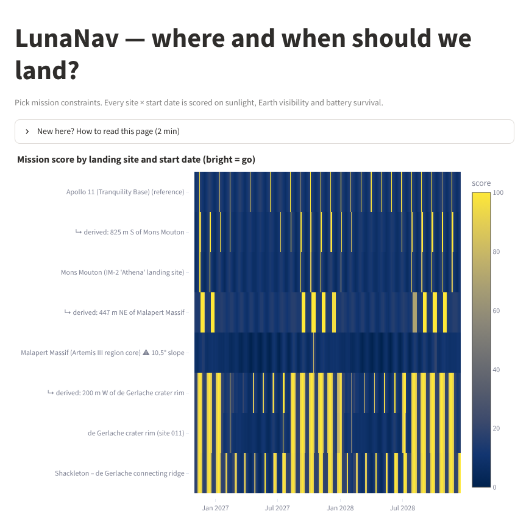
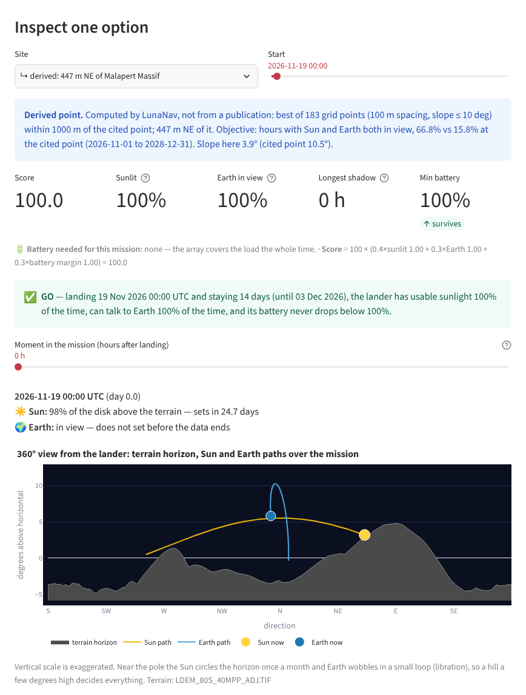

# LunaNav — where and when should we land on the Moon?

NASA Space Apps Challenge 2026 · *Lunar Landing Site Navigator*

[](https://github.com/yutuf/lmNasa/actions/workflows/ci.yml)

Existing tools (QuickMap, Moon Trek, JPL Horizons) are built for detailed analysis.
Answering a simple planning question — *"at this south-pole site, on which dates do we
have Sun and Earth in view, and does the lander survive the night?"* — takes many steps
and expert knowledge. LunaNav answers it in one screen:





- **Score heatmap:** every candidate site × every start date, bright = go (colour-blind-safe).
- **Real terrain horizon:** Sun and Earth are compared against the actual LOLA horizon, not a flat one.
- **Battery survival:** a transparent lander power model shows *when* a mission would die.
- **Battery sizing:** the smallest battery that survives the chosen mission (exact for the model),
  plus a GO / NO-GO verdict in plain words and the score broken down term by term.
- **360° view from the lander:** the terrain silhouette with the Sun's and Earth's paths over the
  mission, plus a time slider — *"on day 5, is the Sun up, and when does it set?"*
- **Communication windows:** when Earth is above the terrain, and when it next sets or rises.
- **Cited vs derived points:** every site is a coordinate copied from a publication (source shown).
  Next to it LunaNav can show a **derived** point: the best spot within 1 km on a gentle slope.
  Always labelled, never a replacement for the cited one.
- **South-pole map** of the sites, true to scale, with the Earth-facing side marked.
- **Shareable links:** the page address always encodes the scenario (settings, site, start date).
- **CSV export** of any mission: hourly Sun/Earth position, terrain, visibility and battery.
- **Plain-language help** in the app for students, educators and the public.

## How it works

```
offline (needs kernels + DEM)                           runtime (Streamlit, light)
──────────────────────────────                          ──────────────────────────
LOLA south-pole DEM ──► build_horizons.py ──► data/horizons.json ─┐
                                                                  ├─► precompute.py ──► data/series/<site>.npz ──► app.py
NAIF kernels (DE440 + Moon frames) ──► lunanav.ephemeris ─────────┘                         (scoring, battery, plots)
                                                                                     │
LOLA DEM + data/series/<cited>.npz ──► derive_best_points.py ──► data/derived_sites.yaml + <site>_derived.npz
```

`derive_best_points.py` needs only the DEM: the Sun and Earth are so far away that moving
1 km on the Moon changes their direction by < 0.0002°, so the cited site's Sun/Earth alt-az series is
rotated into each candidate's local frame instead of re-running the ephemeris. (Checked against
independent DE440 runs: reprojecting Shackleton ridge → de Gerlache rim, ~25 km, matches to 0.0005° in
altitude.)

The app never touches the DEM or the kernels, so it deploys anywhere (Streamlit Community Cloud).

| module | job |
|---|---|
| `lunanav/geometry.py` | great-circle steps, elevation angle with lunar curvature, visible disk fraction |
| `lunanav/horizon.py` | ray-march DEM → 360° horizon profile per site |
| `lunanav/ephemeris.py` | Skyfield: Sun/Earth alt-az from a point in the Moon's ME frame (with libration) |
| `lunanav/visibility.py` | Sun disk fraction above terrain, Earth above terrain |
| `lunanav/power.py` | battery state-of-charge simulation |
| `lunanav/metrics.py` | window metrics, constraints, score, vectorised start-date scan, delay tolerance, set/rise timers |
| `lunanav/panorama.py` | azimuth helpers for the 360° view (circular mean, unwrap, compass ticks) |
| `lunanav/derive.py` | candidate grid, slope, alt-az reprojection, ranking for derived points |
| `lunanav/sites.py` | cited sites (`data/sites.yaml`) + generated derived points (`data/derived_sites.yaml`) |
| `app.py` | Streamlit UI |

## Quick start

```bash
python -m venv .venv && source .venv/bin/activate
pip install -e ".[offline,dev]"
pytest -q          # unit tests + a smoke test that runs the app on the committed data

# real data
python scripts/fetch_kernels.py                          # ~130 MB (DE440)
python scripts/build_horizons.py data/dem/<lola_south_pole>.tif
python scripts/precompute.py --start 2026-11-01 --end 2028-12-31
python scripts/derive_best_points.py data/dem/LDEM_80S_40MPP_ADJ.TIF   # optional: derived points

# or synthetic data just to work on the UI
python scripts/make_demo_series.py

streamlit run app.py
```

## Scoring

For one site and one start date, over the mission duration (1 h steps):

- **sunlit** = share of hours with ≥ 50 % of the solar disk above terrain
- **Earth in view** = share of hours with Earth's center above terrain
- **longest shadow** = longest continuous run of non-sunlit hours
- **battery margin** = (min state of charge − failure line) / (1 − failure line)

`score = 100 × (0.4·sunlit + 0.3·Earth + 0.3·battery margin)`.
If any constraint fails (min sunlit, min Earth, max shadow, battery), the score is ×0.25 and the
reasons are listed. Weights and constraints are editable.

Ties at the top are broken by **delay_ok_days**: how many days the launch can slip with every
later start still feasible.

## Derived points

For each cited, non-reference site: a grid of candidates (100 m spacing) within 1 km, candidates
steeper than 10° (40 m baseline) dropped, a full 360° horizon for each, then ranked by the share of
hours with the Sun (≥ 50 % of the disk) **and** Earth in view; tie-break on sunlight. The cited point
is recomputed with the same DEM and settings so the comparison is fair. If no candidate beats the
cited point, no derived point is written. All three numbers are command-line options.

Result with LOLA `LDEM_80S_40MPP_ADJ`, 2026-11-01 → 2028-12-31 (share of hours):

| cited site | cited: Sun+Earth / Sun / Earth / slope | derived point | derived: Sun+Earth / Sun / Earth / slope |
|---|---|---|---|
| Shackleton connecting ridge | 51.8 % / 91.1 % / 53.9 % / 0.7° | — (cited point is already the best) | — |
| de Gerlache rim (site 011) | 41.3 % / 77.3 % / 57.3 % / 3.4° | 200 m W | 48.8 % / 85.2 % / 57.3 % / 1.6° |
| Malapert Massif | 15.8 % / 42.3 % / 44.1 % / **10.5°** | 447 m NE | 66.8 % / 66.8 % / 100 % / 3.9° |
| Mons Mouton (IM-2) | 38.6 % / 45.5 % / 82.1 % / 2.5° | 825 m S | 43.9 % / 51.5 % / 83.7 % / 1.6° |

The Malapert point is published only to 1° (≈ ±1.5 km), so a 447 m move is well inside its own
uncertainty; its cited coordinate is also steeper than our 10° limit, which the app flags.

## Validation

- Sun/Earth directions cross-checked against JPL Horizons: differences ~0.0001°.
- Shackleton connecting ridge: ≥ 50 % of the solar disk visible 91 % of the time (2026-11 → 2028-12);
  Gläser et al. (EPSC 2014) report 88 % average illumination at 2 m over 20 years for the same spot
  (different metric and period, so close agreement is what we expect, not identity).

## Assumptions (stated, not hidden)

- No atmosphere → no refraction. Altitudes are geometric.
- Spherical Moon, R = 1737.4 km (LOLA reference); terrain from the DEM on top of it.
- Horizon from a 2 m mast, ray-marched to 150 km. Terrain closer than 300 m is ignored (DEM noise).
- Sun disk fraction uses a straight horizon cut across the disk.
- Power: two-axis sun-tracking array (output = peak × visible disk fraction), constant load,
  95 % charge/discharge efficiency. **Illustrative lander, not any real mission.**
- Earth visibility uses Earth's center; no antenna pattern or relay satellites.
- Site coordinates marked † are approximate and must be verified against the cited source.
- Derived points: slope from the 40 m DEM (a lander needs boulder/hazard maps at metre scale too);
  apparent solar radius from the date (±0.3 %).

## License

See `LICENSE`.
