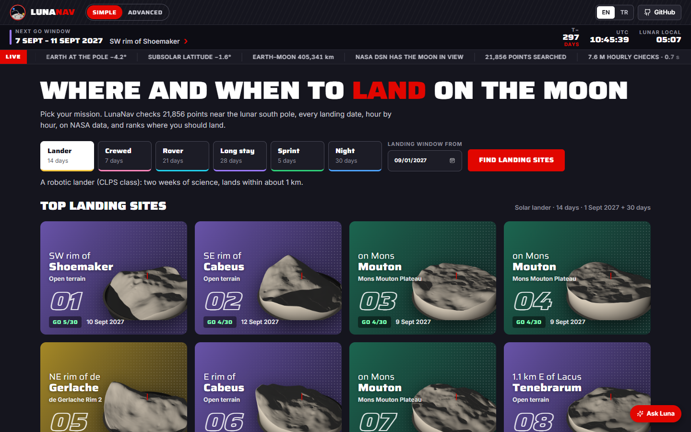
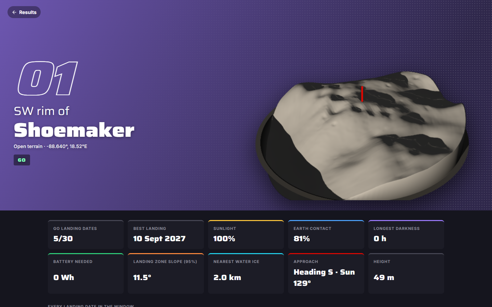
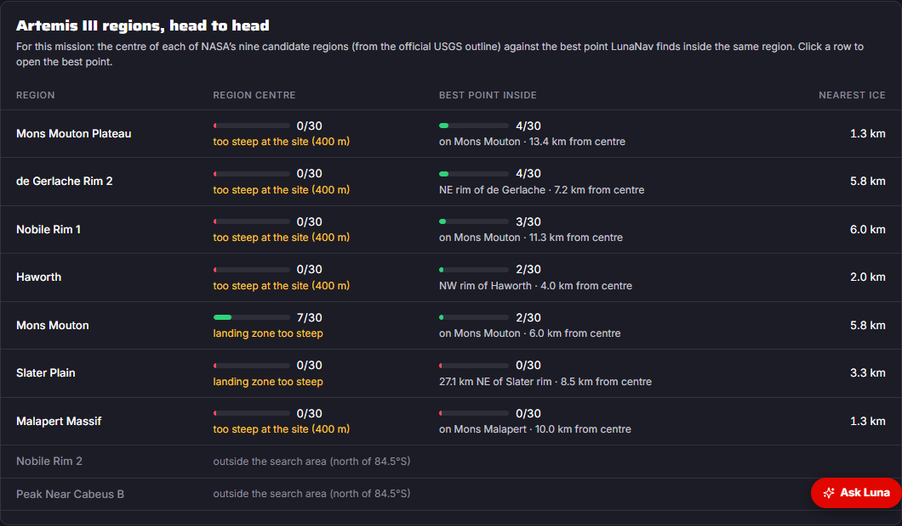
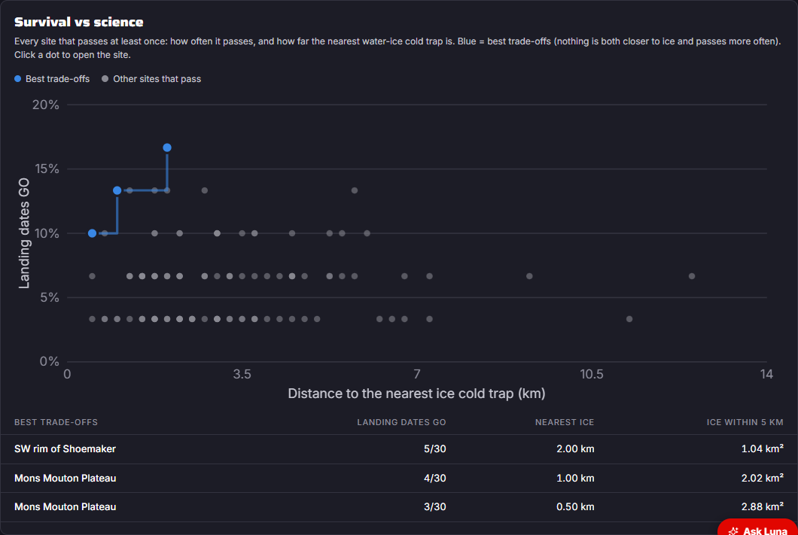
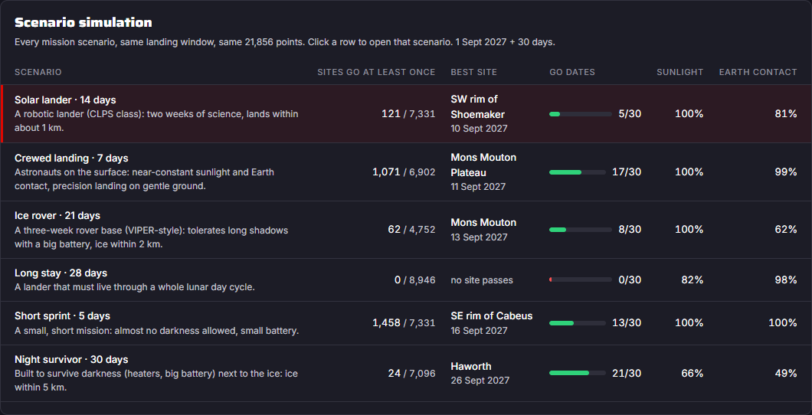
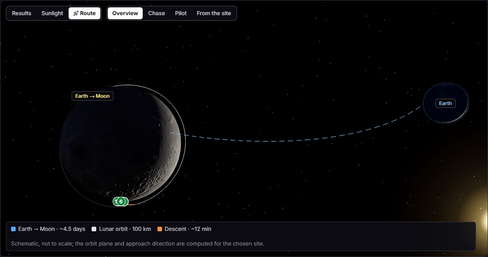
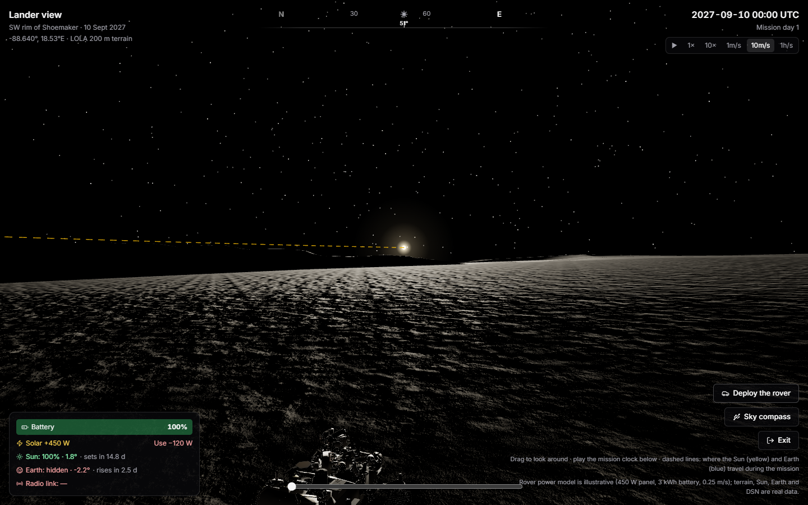
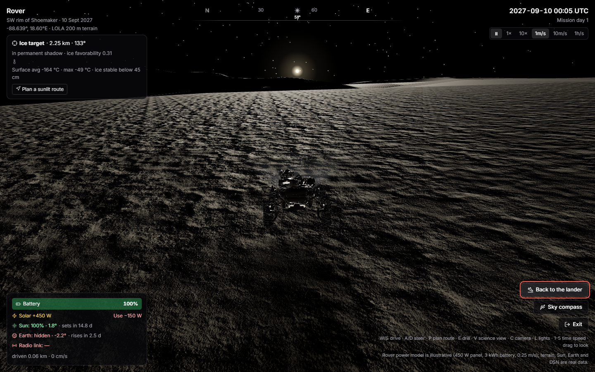

# LunaNav — where and when should we land on the Moon?

Open-source planning tool for landing sites and dates at the lunar south pole: describe a mission, and LunaNav
searches the real terrain hour by hour and tells you where and when a solar lander survives. Then stand on the
lander, or drive a rover there.

[](https://github.com/yutuf/lmNasa/actions/workflows/ci.yml)



Two interfaces: **Simple** (pick a mission and a month, get the top sites as cards, open a site's profile) and
**Advanced** (every requirement, the tables, charts, the Artemis comparison and exports); switch at the top.



## In 30 seconds

**The problem.** At the lunar south pole the Sun skims the horizon, so a few hundred metres decide whether a lander
has power, can talk to Earth, can touch down safely, and is near water ice. Today, answering *"where and on which
date do we land?"* takes several expert tools.

**What LunaNav does.** Pick a mission (or describe it to the guide). In a few seconds it checks **21,856 points × every
landing date × every hour** against NASA LOLA terrain and JPL DE440, and ranks where the mission survives:

- **Survives:** sunlight, Earth contact (with a free NASA DSN dish), the longest darkness, and a battery model.
- **Lands safely:** 95 % of the touchdown zone (100 m to 1 km) is gentler than a limit, from LOLA 40 m slopes.
- **Worth it:** the distance to the nearest *ice cold trap* (permanent shadow where Diviner puts ice within 1 m).
- **Gets there:** a spacecraft route from Earth to a polar orbit to the descent, approaching with the Sun behind it.

**One number.** Under a 14-day robotic-lander mission in September 2027, **every centre of NASA's Artemis III
regions inside the search area fails a terrain check, and LunaNav finds landable points 4–13 km away in five of
them.**

**Checked, not assumed.** Sunlight against NASA's own maps (median +1.9 points, r = 0.96); touchdown slopes against
LOLA's official 40 m slope map (median 1.15°, r = 0.94, 6,620 points); this browser engine against the Python
reference (18 cases identical). The full list is in the app under *Method & data*.

### Built during NASA Space Apps 2026 (14–15 Nov)

The project existed before the event: everything up to the git tag `pre-hackathon` (the site search, horizons,
lander and rover views, and the Python planner). Added during the event, all on top of that tag:

| Added | Where |
|---|---|
| Touchdown zone check (LOLA 40 m slopes, 100 m to 1 km zones), validated against LOLA's slope map | `scripts/build_hazard.py`, `web/src/engine.ts` |
| Water ice: distance to the nearest ice cold trap and cold-trap area within 5 km | `scripts/build_science.py` |
| Survival-vs-science chart with the best trade-offs | `web/src/components/TradeOff.tsx` |
| Six mission scenarios, and a simulation that compares them side by side | `web/src/scenarios.ts` |
| Spacecraft route on the globe, with the approach direction chosen against the Sun | `web/src/flight.ts` |
| Artemis III head-to-head: each region's centre against the best point inside it | `web/src/artemis.ts` |
| Ask Luna works with no AI key (an offline guide, EN/TR); Gemini when a key is set | `web/src/lunaLocal.ts` |
| Validation panel, launch window, 3-step guide; zone, ice and approach in the CSV and report | `web/src/App.tsx`, `web/src/report.ts` |

The plan and progress log: [docs/HACKATHON_PLAN.md](docs/HACKATHON_PLAN.md). A 2-minute demo script for the web app: [docs/DEMO_WEB.md](docs/DEMO_WEB.md).









## The web app (`web/`)

```bash
cd web && npm install && npm run dev        # http://localhost:5173
```

Static site (Vite + React + three.js) with one optional serverless function for the AI guide; deploys to Vercel
with root directory `web` (set `GEMINI_API_KEY` for the AI guide). Everything else runs in the browser, offline.

**Search, not a spot picker.** Set the mission (length, minimum sunlight and Earth contact, longest darkness,
battery, steepest ground, whether Earth contact also needs a free NASA DSN dish) and a landing window. A Web
Worker engine checks all 21,856 points of a 2 km grid around the south pole, every landing date in the window,
hour by hour against each point's real LOLA horizon (about 12 million hourly checks in about a second), and
ranks the sites. The same algorithm as the Python package, checked against it case by case (`web/src/*.test.ts`).

- **Results:** a ranked table with place names from the IAU gazetteer ("SE rim of Shackleton", "on Mons
  Malapert"), the share of landing dates that pass, and the Artemis III region each site falls in; CSV export
  and a printable report; tick two to four rows to compare them side by side.
- **Site detail:** a GO / NO-GO verdict with the reason in one sentence; sunlight, Earth contact, longest
  darkness and battery against the requirements; every landing date in the window; the mission's sunrises,
  sunsets and Earth link losses; better spots within 8 km; eclipses inside the mission (Earth hiding the Sun,
  checked against NASA's eclipse catalogue); what the lander sees, as a 360° horizon with the Sun and Earth
  moving over it; and a calendar of every landing date from November 2026 to the end of 2028.
- **Sunlight map:** scrub or play the mission and watch the shadows sweep across the pole.
- **Copy link:** the address keeps the mission and the chosen site.
- **Ask Luna:** describe a mission in your own words ("a 3-week rover landing in spring 2027 that must always
  reach Earth") or ask about the results; an AI guide (Google Gemini, server-side key) sets up the search or
  explains the numbers, using only what the engine computed. English and Turkish throughout.

**Be there.** From any result, *Stand on the lander* or *Drive a rover here*:



- Real LOLA terrain: 10 m maps from NASA's 5 m/px LOLA site models (Barker et al. 2021) at 15 landing areas,
  the 200 m polar grid elsewhere, lunar curvature included; NASA 3D models (Apollo LM, rover, LRO).
- The Sun and Earth where the ephemeris puts them for that date; ridges cast real shadows (a horizon ray-march
  per vertex for distant ridges, a shadow map nearby); dashed paths show where the Sun and Earth travel during
  the mission.
- A survival game with honest physics: battery, solar input and power use, countdowns to sunset and Earth-set,
  radio link through the DSN, time warp to an hour per second. The rover power figures are illustrative and
  labelled as such.
- A VIPER-style objective: drive to the most ice-favourable permanently shadowed spot nearby (NASA permanent
  shadow map, USGS ice index, Diviner temperatures and ice stability depth), drill for two hours, and bring the
  sample back into sunlight before the battery runs out. A route planner (A* over the terrain, rover slope
  limit, prefers sunlit ground) with an autopilot.
- Keyboard and game controller; a USB LED ring can mirror the rover's sky live ([hardware/sky_link](hardware/sky_link)).



### Data in the web app

| What | Source |
|---|---|
| Terrain horizons, 21,856 points | NASA LRO LOLA polar DEMs (PDS), `scripts/build_horizon_atlas.py` |
| Sun and Earth, hourly | JPL DE440 via Skyfield, Moon-fixed, Earth parallax per point |
| Deep Space Network visibility | Goldstone, Madrid, Canberra, 10° mask |
| 10 m rover terrain | LOLA 5 m/px site DEMs, Barker et al. 2021 (NASA GSFC PGDA product 78) |
| Permanent shadow, average Sun/Earth visibility | Mazarico et al. 2011 (PGDA product 69) |
| Ice favorability index | USGS Astrogeology |
| Surface temperature, ice stability depth | LRO Diviner Polar Resource Product (Paige et al., PDS) |
| Place names | IAU Gazetteer of Planetary Nomenclature (USGS) |
| Artemis III regions | NASA / USGS candidate region outlines |
| 3D models | NASA 3D Resources (`web/public/models/CREDITS.md`) |
| Regolith texture | NASA Artemis south-pole simulation kit (USGS 84S project) |

## The Python package and planner (`lunanav/`, `app.py`)

The science lives in a tested Python package; the original Streamlit planner (live at
https://limitlessapps.streamlit.app/) remains for detailed analysis. Demo video of the planner:
[docs/demo/lunanav-demo.mp4](docs/demo/lunanav-demo.mp4).

Existing tools (QuickMap, Moon Trek, JPL Horizons) are built for detailed analysis.
Answering a simple planning question — *"at this south-pole site, on which dates do we
have Sun and Earth in view, and does the lander survive the night?"* — takes many steps
and expert knowledge. LunaNav answers it in one screen:


- **All nine NASA Artemis III candidate regions** (USGS grids) plus published candidate points, each with
  its source.
- **Score heatmap:** every candidate site × every start date, bright = go (colour-blind-safe), readable
  on a phone; filter by site group.
- **Real terrain horizon:** Sun and Earth are compared against the actual LOLA horizon, not a flat one.
- **Battery survival:** a transparent lander power model shows *when* a mission would die.
- **Battery sizing:** the smallest battery that survives the chosen mission (exact for the model),
  plus a GO / NO-GO verdict in plain words and the score broken down term by term.
- **360° view from the lander:** the terrain silhouette with the Sun's and Earth's paths over the
  mission, plus a time slider — *"on day 5, is the Sun up, and when does it set?"*
- **Communication windows:** when Earth is above the terrain, and when it next sets or rises.
- **English / Türkçe:** a switch at the top translates the simple view (the planner stays in English);
  `?lang=tr` opens the page in Turkish.
- **Anywhere on the Moon:** a whole-Moon relief map and 16 landed missions (Luna 9 to Blue Ghost 1,
  `data/landed_missions.yaml`); outside the south pole the horizon is traced from LOLA's global grid
  (`data/global_grid.npz`, 1.9 km). Sun and Earth tracks are rotated from a computed site with Earth's parallax
  corrected from the hourly Earth-Moon distance (`lunanav/anywhere.py`): checked against independent DE440 runs
  2,700 km away, within 0.018° (without the parallax correction Earth would be off by 0.33°); `tests/test_anywhere.py`.
- **Any point near the pole:** pick a spot south of 84.5°S on a LOLA relief map (or type its coordinates); the
  app traces its horizon on the spot from a compact 200 m / 800 m LOLA grid (`data/polar_grid.npz`, 5 MB) and
  rotates the Sun/Earth track from the nearest computed site. Against the full-resolution horizons at 27 sites:
  sunlit share within 0.5 points (median, worst 4.1), Earth in view within 0.0 (median, worst 13.9 on a narrow
  crest); `tests/test_polar_grid.py`.
- **Deep Space Network check:** Earth above the lander's horizon is not enough; one of NASA's DSN complexes
  (Goldstone, Madrid, Canberra) must also see the Moon. Precomputed hourly (`data/dsn.npz`): each complex sees
  the Moon above 10° about 41 % of the time, at least one of them 98.3 % of the time.
- **Simple view first:** the page opens on one question, five landing spots, a large GO / NO-GO with the reason in
  one sentence, a day-by-day strip, what happens if the launch slips (1 day to 1 month), the same date at the
  other spots, and an animation of the Sun and Earth moving along the real horizon, and a 3D view of the 40 × 40 km of terrain
  around the lander with the shadows the Sun casts at any hour of the mission (`data/terrain/`, cut from LOLA
  by `scripts/make_terrain_patches.py`; shadows from terrain inside the patch only, see `lunanav/terrain3d.py`).
- **Cited vs derived points:** every site comes from a publication: a published point, or the centre of an official
  Artemis III region computed from the USGS grid (source shown).
  Next to it LunaNav can show a **derived** point (the best spot within 1 km on a gentle slope) and, for
  Artemis III regions, the **best point in the whole region**. Always labelled, never a replacement for
  the cited one.
- **South-pole map** of the sites and NASA's nine Artemis III candidate regions (exact USGS grid
  outlines), true to scale, with the Earth-facing side marked.
- **Shareable links:** the page address always encodes the scenario (settings, which site groups are shown,
  site, start date).
- **CSV export** of any mission: hourly Sun/Earth position, terrain, visibility and battery.
- **Plain-language help** in the app for students, educators and the public, and four ready-made
  classroom activities with answers: [docs/EDUCATORS.md](docs/EDUCATORS.md).
- **2-minute demo script** with a link per scene, every verdict checked in CI: [docs/DEMO.md](docs/DEMO.md).
- **Physical twin** (design stage, not yet manufactured): a true-scale 3D-printable relief of Malapert
  Massif with the three demo points, and a 24-LED "horizon compass" PCB that replays a site's Sun and
  Earth directions from LunaNav's data: [hardware/README.md](hardware/README.md).

## Results at a glance

Data: JPL DE440 + LOLA terrain, hourly, 1 Nov 2026 – 31 Dec 2028; "Sun+Earth" = share of hours with at
least half the Sun's disk and Earth's centre above the terrain, seen from a 2 m mast.

- **All nine NASA Artemis III candidate regions are covered** (USGS grids), plus published points
  (Shackleton connecting ridge, de Gerlache rim, Malapert, IM-2 on Mons Mouton) and Apollo 11 for reference.
- **Region centres are poor stand-ins:** Sun+Earth at the centres ranges from 2 % (Slater Plain) to 28 %
  (Nobile Rim 2). Searching each whole region finds ground with **35 % to 84 %** on slopes ≤ 6°, best at
  Malapert Massif (83.6 %, Earth in view all the time), then Mons Mouton (72.5 %) and Nobile Rim 1 (67.9 %).
- **Terrain beats latitude:** at Malapert, moving 447 m from the published point takes Earth visibility
  from 44 % to 100 %.
- **Checked against NASA's independent maps** (Mazarico et al. 2011): for points nobody optimised the
  median difference is +1.9 points (r = 0.957 over 32 points). LunaNav's best-in-region values are
  matched by NASA's own values within ~100 m (median +0.5 points), since the two terrain models place
  narrow crests slightly differently; read them as the upper end of what NASA's maps support. One Earth
  value (Mons Mouton best point, 60 m map) is still unexplained.
- **Found along the way:** the IM-2 landing point lies in the Mons Mouton *Plateau* region, not the
  Mons Mouton one; NASA's regions overlap (e.g. 136 km² shared by Mons Mouton and the Plateau).
- **Limits:** illustrative lander (not a real spacecraft); slope from a 40 m map, so boulders and small
  craters are invisible; no thermal model or relay satellites.

## How it works

```
offline (needs kernels + DEM)                           runtime (Streamlit, light)
──────────────────────────────                          ──────────────────────────
LOLA south-pole DEM ──► build_horizons.py ──► data/horizons.json ─┐
                                                                  ├─► precompute.py ──► data/series/<site>.npz ──► app.py
NAIF kernels (DE440 + Moon frames) ──► lunanav.ephemeris ─────────┘                         (scoring, battery, plots)
                                                                                     │
LOLA DEM + data/series/<cited>.npz ──► derive_best_points.py ──► data/derived_sites.yaml + <site>_derived.npz
USGS Artemis III grids ──► artemis_regions.py ──► region centres (sites.yaml) + outlines (artemis_regions.json)
LOLA DEM + USGS grids + series ──► derive_region_best.py ──► <site>_region_best (derived_sites.yaml + .npz)
```

`derive_best_points.py` needs only the DEM: the Sun and Earth are so far away that moving
1 km on the Moon changes their direction by < 0.0002°, so the cited site's Sun/Earth alt-az series is
rotated into each candidate's local frame instead of re-running the ephemeris. (Checked against
independent DE440 runs: reprojecting Shackleton ridge → de Gerlache rim, ~25 km, matches to 0.0005° in
altitude.)

The app never touches the DEM or the kernels: everything it reads is committed under `data/`, so it
runs from a plain `pip install -r requirements.txt` with no secrets or API keys (see [Deploy](#deploy)).

| module | job |
|---|---|
| `lunanav/geometry.py` | great-circle steps, elevation angle with lunar curvature, visible disk fraction |
| `lunanav/horizon.py` | ray-march DEM → 360° horizon profile per site |
| `lunanav/ephemeris.py` | Skyfield: Sun/Earth alt-az from a point in the Moon's ME frame (with libration) |
| `lunanav/visibility.py` | Sun disk fraction above terrain, Earth above terrain |
| `lunanav/power.py` | battery state-of-charge simulation |
| `lunanav/metrics.py` | window metrics, constraints, score, vectorised start-date scan, delay tolerance, set/rise timers |
| `lunanav/panorama.py` | azimuth helpers for the 360° view (circular mean, unwrap, compass ticks) |
| `lunanav/derive.py` | candidate grid, slope, alt-az reprojection, ranking for derived points |
| `lunanav/outlines.py` | region outlines at runtime (pure numpy): which Artemis III region(s) contain a point |
| `lunanav/regions.py` | USGS region grids: exact inside/outside test, grid points, projection |
| `lunanav/sites.py` | cited sites (`data/sites.yaml`) + generated derived points (`data/derived_sites.yaml`) |
| `app.py` | Streamlit UI |

| script (offline) | needs | writes |
|---|---|---|
| `scripts/fetch_kernels.py` | internet (NAIF) | `data/kernels/` (DE440 + Moon frames) |
| `scripts/build_horizons.py` | LOLA DEM | `data/horizons.json` |
| `scripts/precompute.py` | kernels + `horizons.json` | `data/series/<site>.npz` |
| `scripts/derive_best_points.py` | LOLA DEM + series | `data/derived_sites.yaml`, `<site>_derived.npz`, horizons |
| `scripts/artemis_regions.py` | USGS grid shapefiles | Artemis III region centres in `data/sites.yaml` |
| `scripts/derive_region_best.py` | LOLA DEM + USGS grids + series | best point inside each region (`<site>_region_best`) |
| `scripts/mazarico_compare.py` | NASA PGDA illumination + PSR maps | `data/mazarico.json`: independent check + nearest permanent shadow |
| `scripts/check_map_alignment.py` | two NASA maps | best registration shift between them (diagnostic) |
| `scripts/make_demo_series.py` | nothing | synthetic series for UI work only (clearly flagged in the app) |
| `scripts/make_global_grid.py` | LOLA `ldem_16.img` | `data/global_grid.npz` for horizons anywhere |
| `scripts/precompute_earth_distance.py` | kernels | `data/earth_distance.npz` for Earth parallax |
| `scripts/make_polar_grid.py` | LOLA 85°S 40 m + 80°S 80 m `.img` | `data/polar_grid.npz` for horizons at any point |
| `scripts/make_terrain_patches.py` | LOLA 85°S 40 m `.img` | `data/terrain/<site>.npz` for the 3D view |
| `scripts/precompute_dsn.py` | kernels | `data/dsn.npz`: Moon elevation at the three DSN complexes, hourly |
| `scripts/make_relief.py` | PDS LOLA polar `.img` | 3D-printable terrain tile (`hardware/relief/*.stl` + site positions) |
| `scripts/export_compass_track.py` | a site's series | LED animation for the horizon compass (`firmware/track.h`) |

## Quick start

```bash
python -m venv .venv && source .venv/bin/activate
pip install -e ".[offline,dev]"
pytest -q          # unit tests, an app smoke test, and integrity checks on the committed data

# real data
python scripts/fetch_kernels.py                          # ~130 MB (DE440)
python scripts/build_horizons.py data/dem/<lola_south_pole>.tif
python scripts/precompute.py      # default window 2026-11-01 → 2028-12-31 23:00 UTC (--end 2029-01-01 is exclusive)
python scripts/derive_best_points.py data/dem/LDEM_80S_40MPP_ADJ.TIF   # optional: derived points

# or synthetic data just to work on the UI
python scripts/make_demo_series.py

streamlit run app.py
```

## Deploy

**Web app (Vercel, free):** import `yutuf/lmNasa` at https://vercel.com/new, set *Root Directory* to `web`
(Vite is detected; build `npm run build`, output `dist`), and add the environment variable `GEMINI_API_KEY`
(a free key from https://aistudio.google.com) for the Ask Luna guide; without it everything except Luna works.
Locally the key goes in `web/.env.local` (git-ignored).

**Streamlit planner:** the planner runs on Streamlit Community Cloud at **https://limitlessapps.streamlit.app/**, deployed from this repo's `main` branch.
Locally: `streamlit run app.py`, then open `http://localhost:8501/`.

To deploy a copy (free; needs a GitHub account, and the sign-in can only be done by a person):

1. Sign in at https://share.streamlit.io with GitHub and allow access to `yutuf/lmNasa`.
2. Create app → repository `yutuf/lmNasa`, branch `main`, main file `app.py`.
3. Under Advanced settings pick Python 3.13 (what CI tests); no secrets are needed.
4. Deploy. Dependencies come from `requirements.txt`; the app imports `lunanav/` from the repo root.

## Adding sites

Every site needs a source. Two ways in:

1. **A published point:** add it to `data/sites.yaml` with `source:` (link) and `verified: true` once the
   numbers are copied from that source.
2. **NASA's Artemis III candidate regions** (published as areas of ~20 × 20 km and larger, not points):
   download the USGS navigation grids ([McClernan 2024, doi:10.5066/P1MEQ6UK](https://doi.org/10.5066/P1MEQ6UK)),
   unzip, then `python scripts/artemis_regions.py <folder> --outlines` (`--outlines` also writes the
   region outlines the map draws, `data/artemis_regions.json`). It adds the area-weighted centre of each
   region's 1 km grid as a site, labelled *region centre* (Malapert Massif keeps its published point,
   which lies inside its region; the IM-2 point is inside the Mons Mouton *Plateau* region, so it does
   not stand in for the Mons Mouton region).

Then rebuild the data for the new sites (needs the DEM and kernels):

```bash
python scripts/build_horizons.py data/dem/LDEM_80S_40MPP_ADJ.TIF --sites <new ids>      # other profiles kept
python scripts/precompute.py --sites <new ids>                                          # other series kept
python scripts/derive_best_points.py data/dem/LDEM_80S_40MPP_ADJ.TIF --sites <new ids>
```

Without `--sites` every site is recomputed. `precompute.py --end` is exclusive.

## Scoring

For one site and one start date, over the mission duration (1 h steps):

- **sunlit** = share of hours with ≥ 50 % of the solar disk above terrain
- **Earth in view** = share of hours with Earth's center above terrain
- **longest shadow** = longest continuous run of non-sunlit hours
- **battery margin** = (min state of charge − failure line) / (1 − failure line)

`score = 100 × (0.4·sunlit + 0.3·Earth + 0.3·battery margin)`.
If any constraint fails (min sunlit, min Earth, max shadow, battery), the score is ×0.25 and the
reasons are listed. Constraints are editable in the sidebar; the weights live in `MissionConstraints`.

Ties at the top are broken by **delay_ok_days**: how many days the launch can slip with every
later start still feasible.

## Derived points

For each cited, non-reference site: a grid of candidates (100 m spacing) within 1 km, candidates
steeper than 10° (40 m baseline) dropped, a full 360° horizon for each, then ranked by the share of
hours with the Sun (≥ 50 % of the disk) **and** Earth in view; tie-break on sunlight. The cited point
is recomputed with the same DEM and settings so the comparison is fair. If no candidate beats the
cited point, no derived point is written. All three numbers are command-line options.

Result with LOLA `LDEM_80S_40MPP_ADJ`, 2026-11-01 → 2028-12-31 (share of hours):

| cited site | cited: Sun+Earth / Sun / Earth / slope | derived point | derived: Sun+Earth / Sun / Earth / slope |
|---|---|---|---|
| Shackleton connecting ridge | 51.8 % / 91.1 % / 53.9 % / 0.7° | — (cited point is already the best) | — |
| de Gerlache rim (site 011) | 41.3 % / 77.3 % / 57.3 % / 3.4° | 200 m W | 48.8 % / 85.2 % / 57.3 % / 1.6° |
| Malapert Massif | 15.8 % / 42.3 % / 44.1 % / **10.5°** | 447 m NE | 66.8 % / 66.8 % / 100 % / 3.9° |
| Mons Mouton (IM-2) | 38.6 % / 45.5 % / 82.1 % / 2.5° | 825 m S | 43.9 % / 51.5 % / 83.7 % / 1.6° |

The Malapert point is published only to whole degrees (86°S, 0°E: ±0.5° ≈ ±15 km in latitude,
≈ ±1 km in longitude at 86°S), so a 447 m move is well inside its own uncertainty; its cited
coordinate is also steeper than our 10° limit, which the app flags.

**Artemis III region centres** (centre of each region's USGS 1 km grid; Malapert Massif uses its
published point above, which lies inside its region. The IM-2 point above lies in the Mons Mouton
*Plateau* region, so the Mons Mouton region has its own centre):

| region centre | centre: Sun+Earth / Sun / Earth / slope | derived point | derived: Sun+Earth / Sun / Earth / slope |
|---|---|---|---|
| Peak near Cabeus B | 9.1 % / 37.9 % / 28.8 % / **12.0°** | 943 m NE | 48.3 % / 63.8 % / 77.0 % / 6.8° |
| Mons Mouton Plateau | 20.2 % / 26.1 % / 66.7 % / 2.1° | 1000 m SW | 40.3 % / 46.3 % / 84.7 % / 8.4° |
| Nobile Rim 2 | 28.1 % / 40.8 % / 65.1 % / 4.7° | 1000 m NE | 31.7 % / 46.6 % / 66.0 % / 7.0° |
| Nobile Rim 1 | 9.4 % / 29.2 % / 32.2 % / **16.9°** | 985 m SE | 26.5 % / 50.2 % / 48.1 % / 5.7° |
| de Gerlache Rim 2 | 21.7 % / 37.2 % / 51.3 % / **11.3°** | 500 m NW | 22.0 % / 37.5 % / 51.3 % / 10.0° |
| Haworth | 6.1 % / 10.0 % / 39.6 % / 2.9° | 1000 m SE | 20.7 % / 36.7 % / 50.9 % / 7.2° |
| Slater Plain | 2.0 % / 2.3 % / 36.7 % / 3.4° | 1000 m SE | 9.6 % / 21.5 % / 40.6 % / 9.8° |
| Mons Mouton | 23.8 % / 50.8 % / 55.6 % / 7.1° | 510 m N | 72.5 % / 73.8 % / 98.7 % / 3.2° |

How to read it:
- A region is ~20 × 20 km; its centre is just a reference point, so low numbers there say little about
  the region. The derived point shows what 1 km of freedom buys; the best spots in a region may be
  further away than LunaNav searches.
- Four derived points sit on the 1 km search edge (Plateau, Nobile Rim 2, Haworth, Slater Plain), a
  sign that better ground lies beyond 1 km.
- The objective is Sun + Earth hours with slope only as a ≤ 10° filter, so a derived point can be
  steeper than its centre (Plateau 2.1° → 8.4°, Slater Plain 3.4° → 9.8°).
- de Gerlache Rim 2: the derived point gains only 0.3 points and sits exactly at the 10° limit; treat
  it as "the centre's neighbourhood is already about as good as it gets within 1 km".

## Best point in each Artemis III region


The 1 km search often stops at its own edge. `scripts/derive_region_best.py` searches each whole
region as USGS defines it (the 1 km navigation grid): about 1,500 grid points clipped to the region,
slope ≤ 10°, a full horizon for each, then a 100 m refinement around the five best. Same objective as the
1 km search. The result is a separate, labelled *best in region* point; it never replaces the cited
site or the 1 km derived point. About 2,000 horizons per region.

```bash
python scripts/derive_region_best.py data/dem/LDEM_80S_40MPP_ADJ.TIF <usgs_grid_folder>
```

Each region is searched from the site that stands for it: the published Malapert point (inside its
region) or the region centre. The Sun/Earth series is rotated from that site to each candidate (up to
~43 km for the large Mons Mouton Plateau; Earth parallax ≤ 0.0065°).

Result (LOLA 40 m, 2026-11-01 → 2028-12-31; Sun+Earth = share of hours with both in view):

| region | searched from (Sun+Earth) | best in region | Sun+Earth / Sun / Earth / slope |
|---|---|---|---|
| Malapert Massif | published point (15.8 %) | 5.0 km W | **83.6 %** / 83.6 % / 100 % / 2.4° |
| Mons Mouton | centre (23.8 %) | 0.5 km N | 72.5 % / 73.8 % / 98.7 % / 3.2° (see note) |
| Nobile Rim 1 | centre (9.4 %) | 10.9 km N | 67.9 % / 67.9 % / 99.5 % / 4.0° |
| Mons Mouton Plateau | centre (20.2 %) | 42.9 km E | 56.7 % / 56.7 % / 99.8 % / 5.9° |
| Peak near Cabeus B | centre (9.1 %) | 1.2 km NE | 54.1 % / 70.2 % / 77.6 % / 3.8° |
| Haworth | centre (6.1 %) | 12.2 km N | 53.4 % / 74.8 % / 74.6 % / 3.0° |
| de Gerlache Rim 2 | centre (21.7 %) | 11.2 km S | 46.9 % / 81.6 % / 57.1 % / 3.5° |
| Nobile Rim 2 | centre (28.1 %) | 6.0 km SW | 43.7 % / 51.8 % / 83.0 % / 4.0° |
| Slater Plain | centre (2.0 %) | 5.0 km SE | 34.6 % / 67.0 % / 46.2 % / 1.1° |

- Every region has ground with Sun and Earth together for a third to over four fifths of the time on
  slopes ≤ 6°, often far from the centre: the centre says little about a region.
- **Mons Mouton:** a first run's region search (68.6 %) came out below the 1 km derived point
  (72.5 %, inside the region): the 450 m coarse grid stepped over that narrow peak. The script now also
  refines around the region's site and its known derived points; the rerun returned 72.5 %.
- The Nobile Rim 1 result lies where that region overlaps Mons Mouton Plateau.

## Independent check against NASA's maps, and permanent shadow

`scripts/mazarico_compare.py` reads NASA's polar illumination products (Mazarico et al. 2011, Icarus 211,
[NASA GSFC PGDA product 69](https://pgda.gsfc.nasa.gov/products/69)), 75°S–90°S at 120 m/px: the 18.6-year
average solar illumination, average Earth visibility and the permanent-shadow (PSR) map. For every site
it stores NASA's averages next to LunaNav's own and the distance to the nearest permanently shadowed
region, where water ice can survive (`data/mazarico.json`, shown in the app). Nothing about the encoding
is assumed: GeoTIFF scale tags are applied (the PSR map stores ±20000 with scale 2.5e-5 and offset 0.5,
i.e. 0 and 1), and the PSR code is the value whose pixels average ~0 % sunlight (0.000 % vs 30.6 % for
the other code); the script stops rather than guess.

**Agreement** (mean fraction of the solar disk visible; LunaNav minus NASA):

| points | n | median difference | within ±3 points |
|---|---|---|---|
| published points and region centres | 12 | +1.9 points | 83 % |
| 1 km derived points | 11 | +1.1 points | 55 % |
| best-in-region points | 9 | **+11.3 points** | 33 % |

Correlation over all 32 points: 0.957. Earth visibility is typically 3.5 points *lower* in LunaNav, as
expected: NASA counts Earth as visible when any part of its disc shows, LunaNav uses its centre.

What this means:
- For points nobody optimised, two independent models agree closely: the core geometry holds.
- Points LunaNav **picked as the best of ~2,000 candidates read clearly higher** than NASA's value at
  the same coordinate, but **not higher than NASA's own values right next to them** (see "Crest check"
  below): the gap is mostly about where each map puts a narrow lit crest. Treat best-in-region numbers
  as the upper end of what NASA's maps support there. The same holds for Earth visibility (see "Crest
  check"), with one open exception.
- Largest gaps among published points: Shackleton ridge (NASA 78.3 %, LunaNav 91.1 %; Gläser et al.
  report 88 % at 2 m) and de Gerlache rim (53.1 % vs 77.3 %), both near-grazing-Sun sites at 88–89.5°S
  where observer height is known to matter most.
- **60 m follow-up** (NASA's 85°S–90°S maps, `data/mazarico_60m.json`): the resolution explanation is
  *not* supported. On the same eight best-in-region points the median gap stays the same (+8.7 → +9.2
  points), and the Earth gap grows. NASA's own two maps agree on smooth ground (Haworth centre
  10.7 % / 10.4 %, Slater Plain centre 2.6 % / 2.6 %, de Gerlache Rim 2 centre 38.0 % / 38.0 %) but not
  on narrow ridges: at the Shackleton ridge point the 120 m map gives 78.3 %, the 60 m map 44.3 %
  (Gläser et al.: 88 % at 2 m). A crest is narrower than a pixel or two, so a value sampled exactly
  there swings with any registration offset. Conclusion so far: on smooth ground the two models agree;
  on ridges and peaks a single-point comparison is not decisive either way.
- **Registration check:** `scripts/check_map_alignment.py` compares NASA's 120 m and 60 m maps over
  5,555 pixels between 85.5°S and 89.5°S. The mismatch is 0.0194 at zero shift and the same at the
  "best" shift of 30 m, half a 60 m pixel and below what the method resolves: **the two maps are
  registered**, so a misalignment between them does not explain the ridge values. (In the tests the
  script recovers a planted offset exactly.)
- **Crest check:** `mazarico_compare.py` also records NASA's highest value within 120 m of each site.
  Against that local maximum the best-in-region gap shrinks from +11.3 to **+0.5 points** (median; 78 %
  within ±3) on the 120 m map, and from +9.2 to +5.1 on the 60 m map. At the Shackleton ridge the 60 m
  pixel at the coordinate reads 44.3 % while one 73 m away reads 75.5 %. So NASA's maps do contain values
  like LunaNav's within ~60–110 m: a crest is a pixel or two wide, and the two DEMs (LunaNav: LOLA 40 m
  adjusted; NASA: 2016 LOLA grids) place it slightly differently. A local maximum is itself optimistic
  (for unoptimised points LunaNav sits 0.8 points *below* it), so the honest range on a crest is between
  NASA's point value and its local maximum; LunaNav's best-in-region values sit near the top of it.
- **Earth, same check:** the large Earth gaps were the same effect. At the Malapert best point NASA's
  value at the coordinate is 53.6 %, but its maps reach **100 %** within 120 m (LunaNav: 100 %); Nobile
  Rim 1 best point: NASA up to 91 % within 120 m vs LunaNav 99.6 %. On the 120 m map no point is more
  than 10 points above NASA's local maximum (best-in-region median +0.3). **Open:** the Mons Mouton best
  point (= its 1 km derived point) on the 60 m map: LunaNav 98.7 % vs NASA at most 82.3 % within 120 m
  (89.5 % on the 120 m map). Since NASA counts Earth as visible when *any* part of its disc shows, NASA
  should read higher, not lower, so this one is unexplained.

**Best-in-region points with NASA's numbers and the nearest permanent shadow:**

| best in region | Sun+Earth (LunaNav) | mean Sun: NASA / LunaNav | Earth: NASA / LunaNav | nearest PSR | PSR within 5 km |
|---|---|---|---|---|---|
| Malapert Massif | 83.6 % | 64.1 % / 83.4 % | 53.6 % / 100 % | 0.18 km | 0.06 km² |
| Mons Mouton | 72.5 % | 67.4 % / 73.5 % | 89.5 % / 98.7 % | 1.06 km | 0.92 km² |
| Nobile Rim 1 | 67.9 % | 49.6 % / 67.8 % | 68.3 % / 99.6 % | 1.08 km | 0.88 km² |
| Mons Mouton Plateau | 56.7 % | 56.2 % / 56.7 % | 99.5 % / 99.8 % | 7.00 km | 0.00 km² |
| Peak near Cabeus B | 54.1 % | 53.4 % / 70.2 % | 73.6 % / 77.6 % | 0.74 km | 0.36 km² |
| Haworth | 53.4 % | 63.5 % / 74.8 % | 78.9 % / 74.6 % | 1.19 km | 0.30 km² |
| de Gerlache Rim 2 | 46.9 % | 66.2 % / 81.6 % | 61.6 % / 57.1 % | 2.72 km | 0.91 km² |
| Nobile Rim 2 | 43.7 % | 51.6 % / 51.9 % | 74.6 % / 83.0 % | 2.31 km | 19.21 km² |
| Slater Plain | 34.6 % | 65.6 % / 67.0 % | 49.9 % / 46.2 % | 0.31 km | 0.32 km² |

Nearest-PSR distances come from the 120 m map, which covers every site. At 60 m smaller shadows
appear and many distances shrink (e.g. Mons Mouton Plateau best point 7.0 → 0.95 km, de Gerlache Rim 2
best point 2.72 → 0.25 km), so read the 120 m distances as upper bounds.

For Mons Mouton the seeded region search returned the 1 km derived point itself (72.5 %, 0.5 km N),
closing the gap noted above.

```bash
python scripts/mazarico_compare.py --sun AVGVISIB_75S_120M_201608.TIF \
    --earth AVGVISIB_75S_120M_201608_EARTH.TIF --psr LPSR_75S_120M_201608.TIF [--out other.json]
```

## Validation

- Region membership in the app (outline test in the map plane) agrees with the exact USGS grid-cell
  lookup on all of 36,000 random points around the nine regions.
- NASA's regions overlap (measured on the USGS cells): Mons Mouton shares 136 km² with Mons Mouton
  Plateau and 88 km² with Nobile Rim 1; Plateau and Nobile Rim 1 share 42 km². The app lists every
  region that contains a point.
- Artemis region centres: grid centres lie 0.09–0.47 km from the centres of USGS's own simplified
  region outlines (same release), for all eight computed centres.
- New sites' Sun/Earth series checked against the existing sites' independent DE440 runs (rotated to
  the new point): Sun identical to 0.0000°, Earth within 0.0017° over 14–152 km, inside the expected
  Earth-parallax bound. Derived series re-computed independently: same lit / Earth flag on every hour
  (one borderline hour of 19,008 at Cabeus B, from the solar-radius approximation).
- These checks now run on every push: `tests/test_data_integrity.py`.
- Sun/Earth directions checked against official JPL Horizons output (DE441, observer on the Moon, airless):
  726 positions (3 sites × Sun and Earth × every 6 h in January 2027), largest difference 0.000015°, which is
  the float32 rounding of the stored series. `tests/test_horizons.py` runs on every push against the saved
  Horizons answers in `tests/fixtures/horizons.json` (fetched with `scripts/fetch_horizons_fixture.py`) and
  fails above 0.0001°.
- Shackleton connecting ridge: ≥ 50 % of the solar disk visible 91 % of the time (2026-11 → 2028-12);
  Gläser et al. (EPSC 2014) report 88 % average illumination at 2 m over 20 years for the same spot
  (different metric and period, so close agreement is what we expect, not identity).

## Assumptions (stated, not hidden)

- No atmosphere → no refraction. Altitudes are geometric.
- Spherical Moon, R = 1737.4 km (LOLA reference); terrain from the DEM on top of it.
- Horizon from a 2 m mast, ray-marched to 150 km. Terrain closer than 300 m is ignored (DEM noise).
- Sun disk fraction uses a straight horizon cut across the disk.
- Power: two-axis sun-tracking array (output = peak × visible disk fraction), constant load,
  95 % charge/discharge efficiency. **Illustrative lander, not any real mission.**
- Earth visibility uses Earth's center; no antenna pattern or relay satellites.
- DSN: a link is counted when one complex sees the Moon's centre at least 10° above its horizon (station
  coordinates rounded to 0.001°). Station scheduling, antenna availability and link budgets are not modelled.
- Site coordinates marked † are approximate and must be verified against the cited source.
- Derived points: slope from the 40 m DEM (a lander needs boulder/hazard maps at metre scale too);
  apparent solar radius from the date (±0.3 %).

## License

See `LICENSE`.
