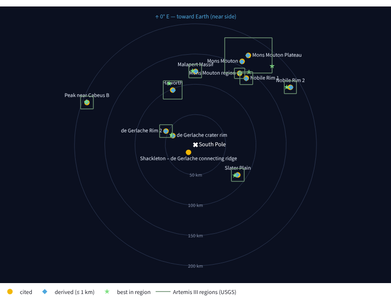

# LunaNav — where and when should we land on the Moon?

NASA Space Apps Challenge 2026 · *Lunar Landing Site Navigator*

[](https://github.com/yutuf/lmNasa/actions/workflows/ci.yml)

Existing tools (QuickMap, Moon Trek, JPL Horizons) are built for detailed analysis.
Answering a simple planning question — *"at this south-pole site, on which dates do we
have Sun and Earth in view, and does the lander survive the night?"* — takes many steps
and expert knowledge. LunaNav answers it in one screen:


- **All nine NASA Artemis III candidate regions** (USGS grids) plus published candidate points, each with
  its source.
- **Score heatmap:** every candidate site × every start date, bright = go (colour-blind-safe), readable
  on a phone; filter by site group.
- **Real terrain horizon:** Sun and Earth are compared against the actual LOLA horizon, not a flat one.
- **Battery survival:** a transparent lander power model shows *when* a mission would die.
- **Battery sizing:** the smallest battery that survives the chosen mission (exact for the model),
  plus a GO / NO-GO verdict in plain words and the score broken down term by term.
- **360° view from the lander:** the terrain silhouette with the Sun's and Earth's paths over the
  mission, plus a time slider — *"on day 5, is the Sun up, and when does it set?"*
- **Communication windows:** when Earth is above the terrain, and when it next sets or rises.
- **Cited vs derived points:** every site comes from a publication: a published point, or the centre of an official
  Artemis III region computed from the USGS grid (source shown).
  Next to it LunaNav can show a **derived** point (the best spot within 1 km on a gentle slope) and, for
  Artemis III regions, the **best point in the whole region**. Always labelled, never a replacement for
  the cited one.
- **South-pole map** of the sites and NASA's nine Artemis III candidate regions (exact USGS grid
  outlines), true to scale, with the Earth-facing side marked.
- **Shareable links:** the page address always encodes the scenario (settings, which site groups are shown,
  site, start date).
- **CSV export** of any mission: hourly Sun/Earth position, terrain, visibility and battery.
- **Plain-language help** in the app for students, educators and the public, and three ready-made
  classroom activities with answers: [docs/EDUCATORS.md](docs/EDUCATORS.md).

## How it works

```
offline (needs kernels + DEM)                           runtime (Streamlit, light)
──────────────────────────────                          ──────────────────────────
LOLA south-pole DEM ──► build_horizons.py ──► data/horizons.json ─┐
                                                                  ├─► precompute.py ──► data/series/<site>.npz ──► app.py
NAIF kernels (DE440 + Moon frames) ──► lunanav.ephemeris ─────────┘                         (scoring, battery, plots)
                                                                                     │
LOLA DEM + data/series/<cited>.npz ──► derive_best_points.py ──► data/derived_sites.yaml + <site>_derived.npz
USGS Artemis III grids ──► artemis_regions.py ──► region centres (sites.yaml) + outlines (artemis_regions.json)
LOLA DEM + USGS grids + series ──► derive_region_best.py ──► <site>_region_best (derived_sites.yaml + .npz)
```

`derive_best_points.py` needs only the DEM: the Sun and Earth are so far away that moving
1 km on the Moon changes their direction by < 0.0002°, so the cited site's Sun/Earth alt-az series is
rotated into each candidate's local frame instead of re-running the ephemeris. (Checked against
independent DE440 runs: reprojecting Shackleton ridge → de Gerlache rim, ~25 km, matches to 0.0005° in
altitude.)

The app never touches the DEM or the kernels, so it deploys anywhere (Streamlit Community Cloud).

| module | job |
|---|---|
| `lunanav/geometry.py` | great-circle steps, elevation angle with lunar curvature, visible disk fraction |
| `lunanav/horizon.py` | ray-march DEM → 360° horizon profile per site |
| `lunanav/ephemeris.py` | Skyfield: Sun/Earth alt-az from a point in the Moon's ME frame (with libration) |
| `lunanav/visibility.py` | Sun disk fraction above terrain, Earth above terrain |
| `lunanav/power.py` | battery state-of-charge simulation |
| `lunanav/metrics.py` | window metrics, constraints, score, vectorised start-date scan, delay tolerance, set/rise timers |
| `lunanav/panorama.py` | azimuth helpers for the 360° view (circular mean, unwrap, compass ticks) |
| `lunanav/derive.py` | candidate grid, slope, alt-az reprojection, ranking for derived points |
| `lunanav/outlines.py` | region outlines at runtime (pure numpy): which Artemis III region(s) contain a point |
| `lunanav/regions.py` | USGS region grids: exact inside/outside test, grid points, projection |
| `lunanav/sites.py` | cited sites (`data/sites.yaml`) + generated derived points (`data/derived_sites.yaml`) |
| `app.py` | Streamlit UI |

| script (offline) | needs | writes |
|---|---|---|
| `scripts/fetch_kernels.py` | internet (NAIF) | `data/kernels/` (DE440 + Moon frames) |
| `scripts/build_horizons.py` | LOLA DEM | `data/horizons.json` |
| `scripts/precompute.py` | kernels + `horizons.json` | `data/series/<site>.npz` |
| `scripts/derive_best_points.py` | LOLA DEM + series | `data/derived_sites.yaml`, `<site>_derived.npz`, horizons |
| `scripts/artemis_regions.py` | USGS grid shapefiles | Artemis III region centres in `data/sites.yaml` |
| `scripts/derive_region_best.py` | LOLA DEM + USGS grids + series | best point inside each region (`<site>_region_best`) |
| `scripts/make_demo_series.py` | nothing | synthetic series for UI work only (clearly flagged in the app) |

## Quick start

```bash
python -m venv .venv && source .venv/bin/activate
pip install -e ".[offline,dev]"
pytest -q          # unit tests, an app smoke test, and integrity checks on the committed data

# real data
python scripts/fetch_kernels.py                          # ~130 MB (DE440)
python scripts/build_horizons.py data/dem/<lola_south_pole>.tif
python scripts/precompute.py      # default window 2026-11-01 → 2028-12-31 23:00 UTC (--end 2029-01-01 is exclusive)
python scripts/derive_best_points.py data/dem/LDEM_80S_40MPP_ADJ.TIF   # optional: derived points

# or synthetic data just to work on the UI
python scripts/make_demo_series.py

streamlit run app.py
```

## Adding sites

Every site needs a source. Two ways in:

1. **A published point:** add it to `data/sites.yaml` with `source:` (link) and `verified: true` once the
   numbers are copied from that source.
2. **NASA's Artemis III candidate regions** (published as areas of ~20 × 20 km and larger, not points):
   download the USGS navigation grids ([McClernan 2024, doi:10.5066/P1MEQ6UK](https://doi.org/10.5066/P1MEQ6UK)),
   unzip, then `python scripts/artemis_regions.py <folder> --outlines` (`--outlines` also writes the
   region outlines the map draws, `data/artemis_regions.json`). It adds the area-weighted centre of each
   region's 1 km grid as a site, labelled *region centre* (Malapert Massif keeps its published point,
   which lies inside its region; the IM-2 point is inside the Mons Mouton *Plateau* region, so it does
   not stand in for the Mons Mouton region).

Then rebuild the data for the new sites (needs the DEM and kernels):

```bash
python scripts/build_horizons.py data/dem/LDEM_80S_40MPP_ADJ.TIF --sites <new ids>      # other profiles kept
python scripts/precompute.py --sites <new ids>                                          # other series kept
python scripts/derive_best_points.py data/dem/LDEM_80S_40MPP_ADJ.TIF --sites <new ids>
```

Without `--sites` every site is recomputed. `precompute.py --end` is exclusive.

## Scoring

For one site and one start date, over the mission duration (1 h steps):

- **sunlit** = share of hours with ≥ 50 % of the solar disk above terrain
- **Earth in view** = share of hours with Earth's center above terrain
- **longest shadow** = longest continuous run of non-sunlit hours
- **battery margin** = (min state of charge − failure line) / (1 − failure line)

`score = 100 × (0.4·sunlit + 0.3·Earth + 0.3·battery margin)`.
If any constraint fails (min sunlit, min Earth, max shadow, battery), the score is ×0.25 and the
reasons are listed. Constraints are editable in the sidebar; the weights live in `MissionConstraints`.

Ties at the top are broken by **delay_ok_days**: how many days the launch can slip with every
later start still feasible.

## Derived points

For each cited, non-reference site: a grid of candidates (100 m spacing) within 1 km, candidates
steeper than 10° (40 m baseline) dropped, a full 360° horizon for each, then ranked by the share of
hours with the Sun (≥ 50 % of the disk) **and** Earth in view; tie-break on sunlight. The cited point
is recomputed with the same DEM and settings so the comparison is fair. If no candidate beats the
cited point, no derived point is written. All three numbers are command-line options.

Result with LOLA `LDEM_80S_40MPP_ADJ`, 2026-11-01 → 2028-12-31 (share of hours):

| cited site | cited: Sun+Earth / Sun / Earth / slope | derived point | derived: Sun+Earth / Sun / Earth / slope |
|---|---|---|---|
| Shackleton connecting ridge | 51.8 % / 91.1 % / 53.9 % / 0.7° | — (cited point is already the best) | — |
| de Gerlache rim (site 011) | 41.3 % / 77.3 % / 57.3 % / 3.4° | 200 m W | 48.8 % / 85.2 % / 57.3 % / 1.6° |
| Malapert Massif | 15.8 % / 42.3 % / 44.1 % / **10.5°** | 447 m NE | 66.8 % / 66.8 % / 100 % / 3.9° |
| Mons Mouton (IM-2) | 38.6 % / 45.5 % / 82.1 % / 2.5° | 825 m S | 43.9 % / 51.5 % / 83.7 % / 1.6° |

The Malapert point is published only to whole degrees (86°S, 0°E: ±0.5° ≈ ±15 km in latitude,
≈ ±1 km in longitude at 86°S), so a 447 m move is well inside its own uncertainty; its cited
coordinate is also steeper than our 10° limit, which the app flags.

**Artemis III region centres** (centre of each region's USGS 1 km grid; Malapert Massif uses its
published point above, which lies inside its region. The Mons Mouton region centre is added but not
computed yet: the IM-2 point above turned out to lie in the Mons Mouton *Plateau* region instead):

| region centre | centre: Sun+Earth / Sun / Earth / slope | derived point | derived: Sun+Earth / Sun / Earth / slope |
|---|---|---|---|
| Peak near Cabeus B | 9.1 % / 37.9 % / 28.8 % / **12.0°** | 943 m NE | 48.3 % / 63.8 % / 77.0 % / 6.8° |
| Mons Mouton Plateau | 20.2 % / 26.1 % / 66.7 % / 2.1° | 1000 m SW | 40.3 % / 46.3 % / 84.7 % / 8.4° |
| Nobile Rim 2 | 28.1 % / 40.8 % / 65.1 % / 4.7° | 1000 m NE | 31.7 % / 46.6 % / 66.0 % / 7.0° |
| Nobile Rim 1 | 9.4 % / 29.2 % / 32.2 % / **16.9°** | 985 m SE | 26.5 % / 50.2 % / 48.1 % / 5.7° |
| de Gerlache Rim 2 | 21.7 % / 37.2 % / 51.3 % / **11.3°** | 500 m NW | 22.0 % / 37.5 % / 51.3 % / 10.0° |
| Haworth | 6.1 % / 10.0 % / 39.6 % / 2.9° | 1000 m SE | 20.7 % / 36.7 % / 50.9 % / 7.2° |
| Slater Plain | 2.0 % / 2.3 % / 36.7 % / 3.4° | 1000 m SE | 9.6 % / 21.5 % / 40.6 % / 9.8° |

How to read it:
- A region is ~20 × 20 km; its centre is just a reference point, so low numbers there say little about
  the region. The derived point shows what 1 km of freedom buys; the best spots in a region may be
  further away than LunaNav searches.
- Four derived points sit on the 1 km search edge (Plateau, Nobile Rim 2, Haworth, Slater Plain), a
  sign that better ground lies beyond 1 km.
- The objective is Sun + Earth hours with slope only as a ≤ 10° filter, so a derived point can be
  steeper than its centre (Plateau 2.1° → 8.4°, Slater Plain 3.4° → 9.8°).
- de Gerlache Rim 2: the derived point gains only 0.3 points and sits exactly at the 10° limit; treat
  it as "the centre's neighbourhood is already about as good as it gets within 1 km".

## Best point in each Artemis III region



The 1 km search often stops at its own edge. `scripts/derive_region_best.py` searches each whole
region as USGS defines it (the 1 km navigation grid): about 1,500 grid points clipped to the region,
slope ≤ 10°, a full horizon for each, then a 100 m refinement around the five best. Same objective as the
1 km search. The result is a separate, labelled *best in region* point; it never replaces the cited
site or the 1 km derived point. About 2,000 horizons per region.

```bash
python scripts/derive_region_best.py data/dem/LDEM_80S_40MPP_ADJ.TIF <usgs_grid_folder>
```

Each region is searched from the site that stands for it: the published Malapert point (inside its
region) or the region centre. The Sun/Earth series is rotated from that site to each candidate (≤ ~40 km
for the large Mons Mouton Plateau; Earth parallax ≤ 0.006°).

## Validation

- Region membership in the app (outline test in the map plane) agrees with the exact USGS grid-cell
  lookup on all of 36,000 random points around the nine regions.
- NASA's regions overlap (measured on the USGS cells): Mons Mouton shares 136 km² with Mons Mouton
  Plateau and 88 km² with Nobile Rim 1; Plateau and Nobile Rim 1 share 42 km². The app lists every
  region that contains a point.
- Artemis region centres: grid centres lie 0.09–0.47 km from the centres of USGS's own simplified
  region outlines (same release), for all eight computed centres.
- New sites' Sun/Earth series checked against the existing sites' independent DE440 runs (rotated to
  the new point): Sun identical to 0.0000°, Earth within 0.0017° over 14–152 km, inside the expected
  Earth-parallax bound. Derived series re-computed independently: same lit / Earth flag on every hour
  (one borderline hour of 19,008 at Cabeus B, from the solar-radius approximation).
- These checks now run on every push: `tests/test_data_integrity.py`.
- Sun/Earth directions cross-checked against JPL Horizons: differences ~0.0001°.
- Shackleton connecting ridge: ≥ 50 % of the solar disk visible 91 % of the time (2026-11 → 2028-12);
  Gläser et al. (EPSC 2014) report 88 % average illumination at 2 m over 20 years for the same spot
  (different metric and period, so close agreement is what we expect, not identity).

## Assumptions (stated, not hidden)

- No atmosphere → no refraction. Altitudes are geometric.
- Spherical Moon, R = 1737.4 km (LOLA reference); terrain from the DEM on top of it.
- Horizon from a 2 m mast, ray-marched to 150 km. Terrain closer than 300 m is ignored (DEM noise).
- Sun disk fraction uses a straight horizon cut across the disk.
- Power: two-axis sun-tracking array (output = peak × visible disk fraction), constant load,
  95 % charge/discharge efficiency. **Illustrative lander, not any real mission.**
- Earth visibility uses Earth's center; no antenna pattern or relay satellites.
- Site coordinates marked † are approximate and must be verified against the cited source.
- Derived points: slope from the 40 m DEM (a lander needs boulder/hazard maps at metre scale too);
  apparent solar radius from the date (±0.3 %).

## License

See `LICENSE`.
