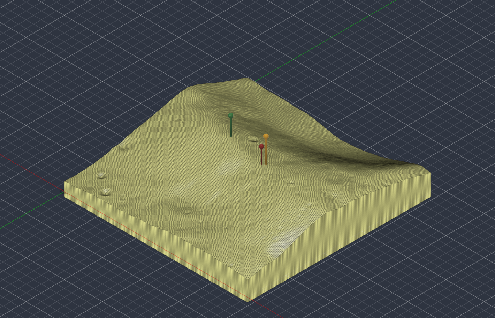
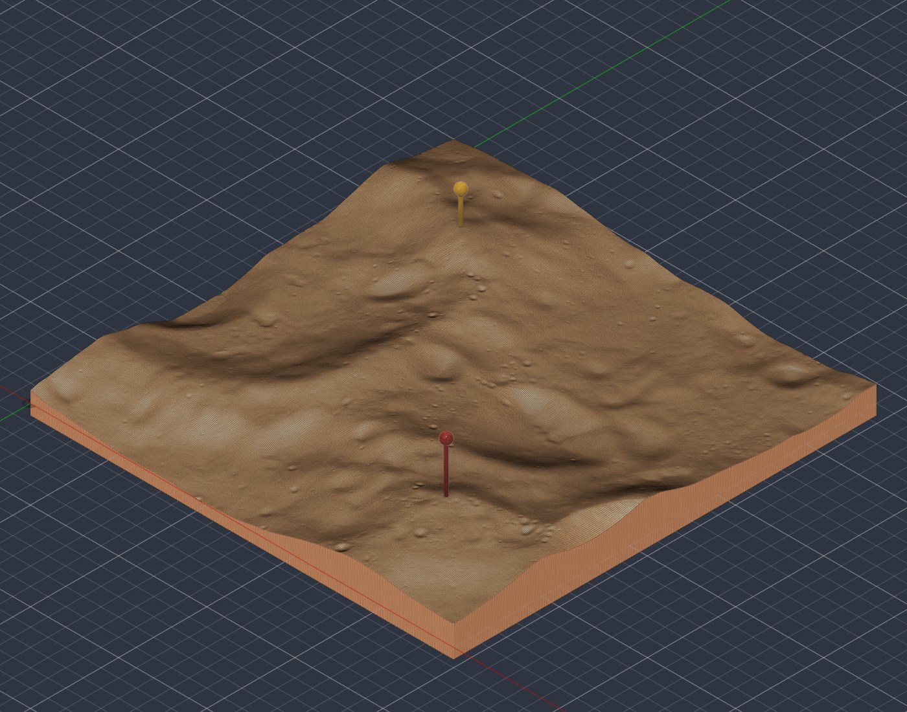
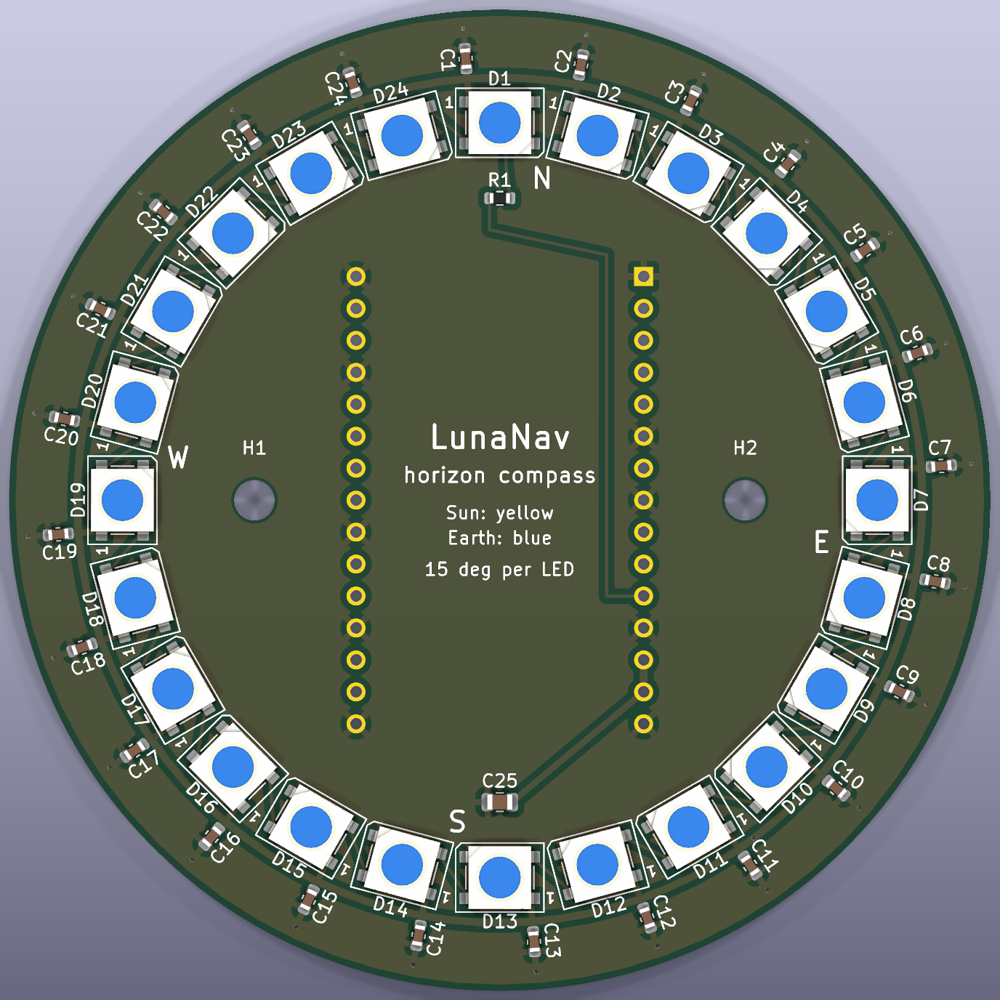
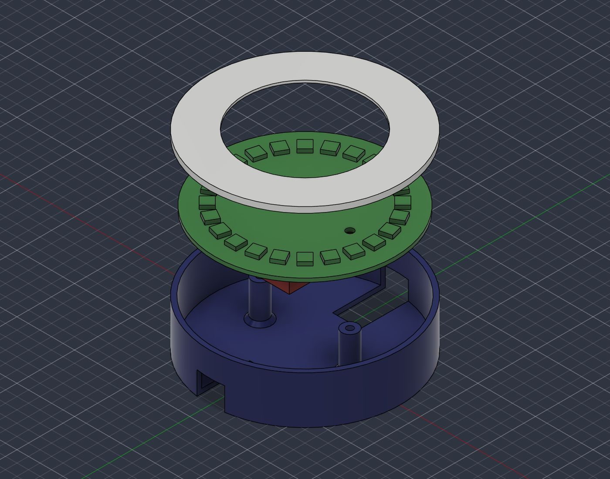

# LunaNav physical twin

Physical companions to the app, generated from scripts so they can be rebuilt for any site.
**None of them has been manufactured yet.**

| | what | where |
|---|---|---|
| 1 | Terrain reliefs: Malapert Massif, and Shackleton ridge with de Gerlache rim | `relief/` |
| 2 | Horizon compass: 24-LED ring PCB, its printable stand, firmware sketch | `horizon_compass/` |
| 3 | Timeline bar: 3 × 28 LED PCB, three landing spots day by day | `timeline_bar/` |
| 4 | Site map: a PCB map of the south pole with an LED per Artemis III region | `site_map/` |
| 5 | Sky link: any ESP32 + NeoPixel ring mirrors the Sun and Earth around the rover you drive in the web app, live over USB (Web Serial) | `sky_link/` |

Pin mappings are checked against KiCad's own symbol library with `tools/kicad_pins.py`.

## 1. Terrain relief of Malapert Massif



The 24 × 24 km tile from the demo ("terrain beats latitude"), at **1:200,000 with true vertical scale**:
120 mm square, 24.2 mm of relief (4,845 m of real elevation range), 3 mm base.

| pin | point | elevation |
|---|---|---|
| A (red) | published point, 86°S 0°E | 4,795 m |
| B (yellow) | LunaNav derived point, 447 m NE | 4,851 m |
| C (green) | best point in the Artemis III region, 5 km W | 4,990 m |

Pins A and B are 2.2 mm apart on the model: that is how small the move is that takes Earth
visibility from 44 % to 100 %.

| file | what |
|---|---|
| `relief/malapert_massif.stl` | watertight solid, millimetres, 82,400 triangles: ready to slice |
| `relief/malapert_massif.json` | tile metadata and the model-space position of each point |
| `relief/malapert_massif.f3d` | Fusion archive: the mesh plus the three pins as solid bodies |

Rebuild, or make another tile (any site ids from `data/sites.yaml` / `data/derived_sites.yaml`):

```bash
# DEM: ldem_85s_40m.img + .lbl (115 MB) from
# https://pds-geosciences.wustl.edu/lro/lro-l-lola-3-rdr-v1/lrolol_1xxx/data/lola_gdr/polar/img/
python scripts/make_relief.py data/dem/ldem_85s_40m.img \
    --sites malapert_massif malapert_massif_derived malapert_massif_region_best \
    --size-km 24 --scale 200000 --out hardware/relief/malapert_massif
```

Orientation: +y points toward longitude 0 (the Earth-facing side), +x toward 90°E. The DEM orientation
was checked on Shackleton crater (floor at −2,788 m where expected; the mirrored coordinate gives +676 m).
Note this is the PDS `ldem_85s_40m` product, not the adjusted `LDEM_80S_40MPP_ADJ` grid the app's
horizons use, so elevations can differ by a few metres.

### Second tile: Shackleton connecting ridge and de Gerlache rim



The two classic near-pole candidates, 37.8 km apart, on one 48 × 48 km tile at **1:400,000 with true
vertical scale**: 120 mm square, 10.8 mm of relief (−2,353.5 m to 1,956 m), 3 mm base. In LunaNav's
data the ridge point has at least half the solar disk in view 91 % of the time and the rim point 77 %
(2026-11 → 2028-12).

| pin | point | elevation |
|---|---|---|
| red | Shackleton connecting ridge | 1,954.5 m |
| yellow | de Gerlache rim (site 011) | 1,810.5 m |

`relief/shackleton_ridge.stl` (82,400 triangles) and `.json` were made with `--sites shackleton_ridge
de_gerlache_rim --size-km 48 --scale 400000 --step 6`, which gives the same 0.6 mm model resolution as
the Malapert tile. The Fusion archive `relief/shackleton_ridge.f3d` was built from the same tile
sampled twice as finely (`--step 3`), so its pin heights differ from the JSON by about 0.02 mm.

## 2. Horizon compass (PCB)



A ring of 24 addressable LEDs, one per 15° of azimuth, around an ESP32-C3-DevKitM-1 that plugs into the
back. Idea: for a chosen site, light the LED in the Sun's direction yellow and the Earth's direction
blue, brightness following elevation above the terrain horizon, and replay a lunar day in seconds.

- 78 mm round, 2 layers, ground pour on both sides
- D1–D24 WS2812B (5050), C1–C24 100 nF, C25 10 µF, R1 330 Ω in the data line
- The whole board is generated by `horizon_compass/generate_board.py` (KiCad Python API)
- `horizon_compass/horizon_compass.step`: the board as a STEP solid, for CAD

```bash
cd hardware/horizon_compass
"C:/Program Files/KiCad/10.0/bin/python.exe" generate_board.py
kicad-cli pcb drc --refill-zones --save-board horizon_compass.kicad_pcb   # fills the ground pours
```

**Status: layout concept, not ready to order.** KiCad 10.0.4 DRC reports 0 violations and 0 unconnected
items, but:

- There is no schematic; the netlist lives in the script.
- The DevKitM-1 pin numbers (5V = 13/14, data = pin 11 / IO10, ten grounds) are checked against KiCad's
  own symbol with `tools/kicad_pins.py`; that check caught IO6 tied to ground in the first draft. The
  footprint has not been checked against a physical devkit yet.
- 3.3 V data into 5 V WS2812B usually works but is out of spec; add a level shifter if it flickers.
- All 24 LEDs at full white draw about 1.4 A, more than USB through the devkit can supply. The intended
  use lights two LEDs; firmware must cap brightness.
- The ground pour runs under the devkit's antenna; add a keep-out there.
- The LED chain runs counter-clockwise from D1 (north). Two M3 mounting holes sit left and right of the devkit.

### Firmware and data

`scripts/export_compass_track.py` turns any site's precomputed series into `firmware/track.h`: per hour,
the LED facing the Sun, its brightness (visible fraction of the solar disk above the terrain) and the LED
facing Earth (lit while Earth's centre is above the terrain). `firmware/firmware.ino` (Arduino core for
ESP32, Adafruit NeoPixel) replays it at one hour per frame, so 30 days take about a minute.

```bash
python scripts/export_compass_track.py malapert_massif --start 2027-09-09 --days 30               # committed default
python scripts/export_compass_track.py malapert_massif_region_best --start 2027-09-09 --days 30   # 5 km west
```

Same 30 days, two spots 5 km apart: at the published point the Sun LED is lit in 64 % of the 720 frames
and the Earth LED in 40 %; at the best point in the region both stay on in every frame. **The firmware
has not been compiled or run on hardware yet.**

### Stand



A two-part printable stand modelled in Fusion: a base cup the board screws into (82.6 mm outer
diameter, 20.6 mm tall, two posts under the M3 holes, a cable slot at each end of the devkit) and a
diffuser ring that rests on the rim over the LEDs. Dimensions, the clearances measured in CAD and the
list of what is unverified are in [horizon_compass/enclosure/README.md](horizon_compass/enclosure/README.md).
Never printed or test-fitted.
