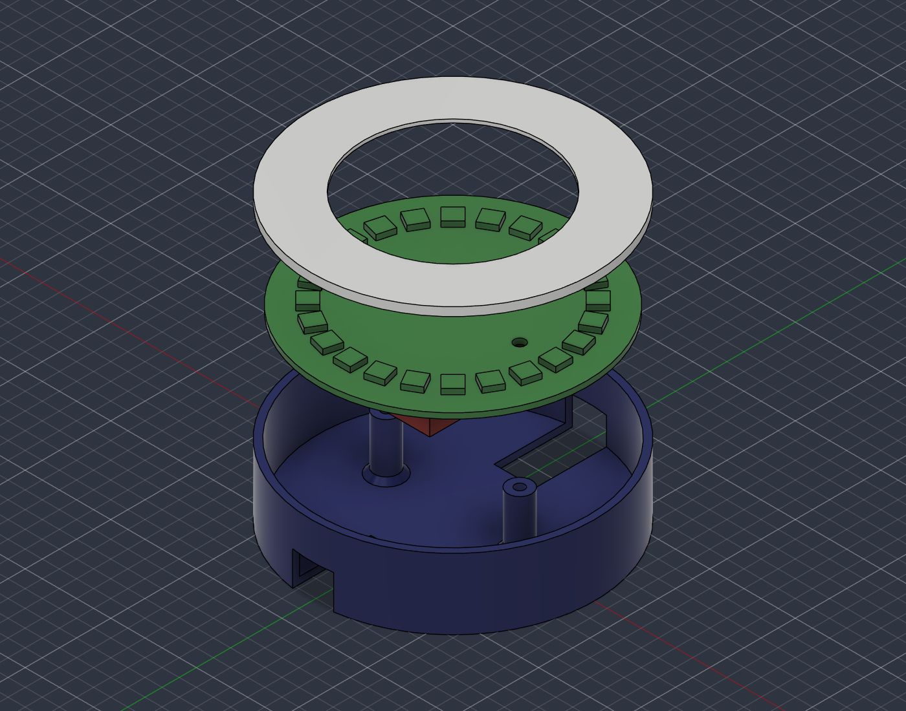

# Horizon compass stand



A two-part printable stand for the horizon compass board in the parent folder: a **base cup** the
board screws into, and a **diffuser ring** that drops onto the rim and covers the LED ring.
**Neither part has been printed or test-fitted.** The board itself has not been manufactured either,
so every fit below is CAD against CAD.

The picture is an exploded view made for this README (board and devkit lifted 35 mm, ring lifted
60 mm). The green and red bodies are references, not parts to print.

| file | what |
|---|---|
| `base_cup.stl` | the cup, millimetres, floor on the bed, 2,150 triangles |
| `diffuser_ring.stl` | the ring, millimetres, flipped so the flat plate is on the bed, 1,760 triangles |
| `compass_stand.f3d` | Fusion archive: both parts assembled, plus `ref_pcb_with_leds` and `ref_devkit_keep_in` |
| `build_stand.py` | Fusion script that models, checks and exports all of the above |
| `board_extents.py` | reads `../horizon_compass.kicad_pcb` and prints where the parts sit (KiCad Python) |
| `enclosure.png` | the screenshot above |

## Dimensions

Origin at the centre of the cup, z = 0 on the table, +y = north on the board, +x = east.

**Base cup** (82.6 mm outer diameter, 20.6 mm tall, 19.78 cm³ of plastic)

- floor 2 mm, wall 2 mm, inner diameter 78.6 mm (the board is 78 mm: 0.3 mm of play all round)
- two posts at x = ±19.5 mm under the M3 holes: 7 mm diameter, 16 mm tall, with a 45° foot that is
  10 mm wide at the floor. Their tops (z = 18 mm) carry the board. Each has a 2.8 mm pilot hole, 12 mm deep.
- the board's top face is at z = 19.6 mm, 1 mm below the rim (z = 20.6 mm)
- two cable slots in the wall, north and south: 12 mm wide, 8 mm high, from the floor top (z = 2 mm)
  to z = 10 mm. Under each slot the floor is notched as well, 12 mm wide, from 18 mm off-centre out
  through the wall. See "Choices" for why.

**Diffuser ring** (82.6 mm outer diameter, 3.2 mm tall, 4.71 cm³)

- flat plate 1 mm thick, inner radius 26 mm, outer radius 41.3 mm (flush with the cup). It covers the
  LED annulus (26 to 35 mm) and everything outside it; the centre of the board stays open.
- under the plate, a 1.5 mm spacer (radius 37.9 to 41.3 mm) that sits on the rim
- under the spacer, a locating lip 0.7 mm deep and 1.2 mm wide (radius 37.9 to 39.1 mm) that drops
  inside the cup wall with 0.2 mm of radial play

## Clearances

Measured in Fusion on the finished bodies (`measureMinimumDistance`, `analyzeInterference`), against
a reference board (78 mm disc, 1.6 mm thick, 24 LED blocks 5 × 5 × 1.6 mm on the 30 mm ring) and a
devkit keep-in volume (25.4 × 39 mm, the full 16 mm between floor and board, plus the antenna tab the
KiCad footprint draws at the north end).

| check | result |
|---|---|
| any two bodies sharing volume | none (interference analysis returns 0 results) |
| post shaft to devkit edge (19.5 − 3.5 − 12.7) | 3.3 mm |
| post foot to devkit edge, at the floor | 1.8 mm |
| board edge to cup wall | 0.3 mm |
| plate underside (z = 22.1 mm) to LED tops (z = 21.2 mm) | 0.9 mm |
| locating lip to board top face | 0.3 mm |
| locating lip (inner radius 37.9 mm) to outermost capacitor pad (radius 36.76 mm) | 1.1 mm |
| locating lip to cup wall | 0.2 mm |
| +5V track on the back of the board to the nearest post centre | 17.2 mm |

From `board_extents.py`: holes at (±19.5, 0), 3.2 mm; devkit pads span x ±11.43, y ±17.78 mm;
LED pads reach radius 27.3 to 32.9 mm; capacitor pads reach 36.76 mm; the outermost via copper is at
37.9 mm (flat, under the lip's 0.3 mm gap).

Both STL files are closed (every edge shared by exactly two triangles) and were read back in
millimetres: 82.6 × 82.6 × 20.6 mm and 82.6 × 82.6 × 3.2 mm.

## Printing

- **Cup**: as exported, floor on the bed. No supports. The only overhangs are the two slot roofs at
  z = 10 mm: flat bridges 12 mm long and 2 mm deep (24 mm² each).
- **Ring**: as exported, upside down with the plate on the bed. No supports; each step is narrower
  than the one printed before it. At a 0.2 mm layer the plate is 5 layers.
- **Material** (suggestion, not tested): cup in any opaque PLA or PETG; ring in natural, white or
  translucent filament so the LEDs show through. Solid plastic volume is 19.78 + 4.71 cm³.
- **Fixing**: two M3 screws through the board into the pilot holes. The ring is not fastened; it
  rests on the rim.

## Rebuild

```bash
# board numbers the stand is built around (read-only)
"C:/Program Files/KiCad/10.0/bin/python.exe" hardware/horizon_compass/enclosure/board_extents.py
```

`build_stand.py` runs inside Fusion. All dimensions are constants at the top of the file. It opens a
new document and writes the `.f3d` and both `.stl` files next to itself. It was run through the
Fusion MCP server with a three-line wrapper (`runpy.run_path(".../build_stand.py")["run"]("")`);
starting it from Fusion's Scripts dialog has not been tried.

## Choices that differ from a literal reading of the brief

1. **The ring stands 1.5 mm above the rim instead of lying flat on it.** The LED bodies (1.6 mm) end
   0.6 mm *above* the rim, because the rim is only 1 mm above the board. A plate lying on the rim
   would cut through them. The 1.5 mm that was meant as the lip is used as a spacer, which leaves
   0.9 mm over the LEDs.
2. **The locating lip is 0.7 mm deep, not 1.5 mm.** With the board 1 mm below the rim there is no
   room for more.
3. **The floor is notched under each cable slot.** With 16 mm between floor and board, the devkit's
   USB connector ends up a few millimetres above the floor, and a cable plug is thicker than that.
   The estimate behind this uses catalogue heights that were not measured on real parts (socket
   header 8.5 mm, pin-header spacer 2.5 mm, devkit board 1.6 mm, which puts the devkit's component
   side at z = 5.4 mm). The notch lets the plug hang down to table level. Wall slot plus notch give an
   opening 12 mm wide and 10 mm high, starting at the table.
4. **Posts are 7 mm wide with a 10 mm foot**, pilot holes 12 mm deep. The brief did not give these.

## Not verified

- Nothing has been printed. Play values (0.3 mm board to wall, 0.2 mm lip to wall, 0.3 mm lip to
  board) are nominal CAD numbers, not tuned for any printer.
- The devkit height stack in choice 3 is an estimate. If the real stack is taller than 16 mm the board
  will not seat on the posts; if the USB connector sits elsewhere the slots may miss it.
- Which end the USB connector is on. KiCad's footprint draws the antenna beyond pin 1, and pin 1 is at
  the north end of this board, which would put USB at the south slot. That was not checked against a
  physical devkit, so both ends are slotted.
- The 1.6 mm LED height is the nominal body height; the 0.9 mm gap depends on it.
- How well a 1 mm plate 0.9 mm above the LEDs diffuses. It is very close, so expect visible hot
  spots rather than an even glow.
- Screw fit. 2.8 mm is the modelled diameter; printed holes usually come out smaller, and a 3 mm
  thread has only 0.1 mm per side to bite into at the nominal size. Which screw type holds has not been tried.
- The ring has no retention and no index mark; it can be lifted off or turned freely.
- The post tops (7 mm) are wider than the 3.2 mm holes and press on the solder mask over the back
  ground pour.
- Heat: the cup is closed apart from the two slots. Nothing was estimated for LED or regulator temperature.
