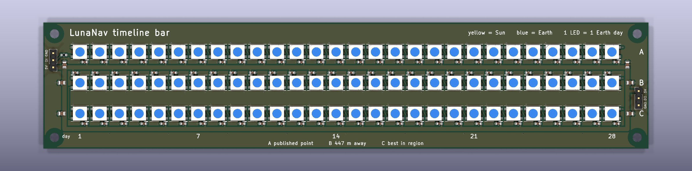

# Timeline bar (PCB)



The app's central comparison as light: three rows of 28 addressable LEDs. A row is one landing spot,
an LED is one Earth day of a 28-day window. Each LED mixes yellow (share of that day's hours with at
least half the solar disk above the terrain) and blue (share of that day's hours with Earth above the
terrain). The three rows are the three demo spots at Malapert Massif, all within 5 km of each other:

| row | site id | what |
|---|---|---|
| A | `malapert_massif` | published point |
| B | `malapert_massif_derived` | 447 m away |
| C | `malapert_massif_region_best` | best in region, 5 km west |

The board has no controller. 5 V and data come in on J1 at the left edge and leave on J2 at the right
edge. **Nothing here has been manufactured, and the firmware has never been compiled.**

## The board

- 215 x 45 mm rectangle, 2 layers, 4 M3 holes (3.2 mm drill) 4 mm in from each corner
- D1-D84 WS2812B (5050) on a 7.0 mm pitch, rows 11.0 mm apart; day 1 is the left column
- C1-C84 100 nF 0603, one per LED, its +5V pad 1.95 mm (centre to centre) from the LED's VDD pad
- C85-C90 10 uF 0805, one at each end of each row
- R1 330 ohm 0603 in the data line between J1 and D1
- J1 (input, left edge) and J2 (output, right edge): 1x3 2.54 mm pin headers
- Silkscreen: title, legend (yellow = Sun, blue = Earth, 1 LED = 1 Earth day), day numbers 1, 7, 14,
  21, 28 under the columns, row letters A, B, C at the right end and their meaning along the bottom
  edge. LED and capacitor designators are hidden: there is no room on a 7 mm pitch.

| header | pin 1 | pin 2 | pin 3 |
|---|---|---|---|
| J1, pin 1 lowest | 5V | DIN (to R1, then D1) | GND |
| J2, pin 1 highest | 5V | DOUT (from D84) | GND |

### LED chain order

One serpentine chain. `scripts/export_timeline_track.py` uses the same order (both files carry the
same `chain_index` function).

| chain index | LEDs | row | direction |
|---|---|---|---|
| 0-27 | D1-D28 | A | day 1 to 28, left to right |
| 28-55 | D29-D56 | B | day 28 to 1, right to left |
| 56-83 | D57-D84 | C | day 1 to 28, left to right |

So D1 = row A day 1, D28 = row A day 28, D29 = row B day 28, D56 = row B day 1, D57 = row C day 1,
D84 = row C day 28. Reading the saved board back confirms that DOUT of every LED is on the same net as
DIN of the next, D1's DIN goes to R1 and D84's DOUT to J2.

### Numbers printed by the generator and read back from the saved board

- LED orientation: rows A and C 180 degrees, row B 0 degrees (chosen by measuring the pads so DIN
  faces the previous LED)
- Data hop inside a row: 3.91 mm. Row A to B at the right end: 13.90 mm with 2 vias (it crosses the
  shared +5V bus on the back layer). Row B to C at the left end: 14.10 mm on the front.
- +5V: one 1.5 mm bus between rows A and B (204.0 mm, shared by both rows) and one below row C
  (200.0 mm), joined by 1.5 mm vertical tracks at x = 7.5 mm and x = 207.5 mm. Each LED reaches its
  bus through a 0.5 mm stub via its 100 nF capacitor. J2's 5V pin hangs on a 4.0 mm long, 1.0 mm wide
  track.
- GND: pours on both layers, 186 vias in total of which 183 are ground (one per LED VSS pad, one per
  capacitor, 9 stitching vias below row C); the other 3 carry data.
- Data tracks 0.25 mm, ground stubs 0.4 mm.
- Nearest copper to a mounting hole: track centre 4.61 mm from the hole centre (the 1.5 mm +5V bus at
  the two lower holes), so copper starts 3.86 mm from the centre. The pours are kept out to a radius
  of 3.4 mm around each hole.
- KiCad 10.0.4 DRC (errors and warnings): 0 violations, 0 unconnected items. See `drc_report.txt`.

### Current limit: read this before powering it

A WS2812B draws about 20 mA per colour at full brightness, 60 mA at full white (typical datasheet
figure, not measured here). 84 x 60 mA = **5.04 A at full white**. That is far more than these tracks
or a USB port can carry: the IPC-2221 estimate for a 1.5 mm outer-layer track in 35 um copper at a
10 degree rise is 3.2 A, and for the 1.0 mm stub to J2 2.4 A.

Firmware must cap brightness. Worst case is every LED with all three colours at the cap (row C of the
default data is exactly that: Sun and Earth both at 100 % on all 28 days). Allowing 1 mA idle current
per LED (84 mA, also a typical figure):

    84 x 60 mA x cap/255 + 84 mA < 1000 mA   ->   cap <= 46 of 255 (18 %)

At 46 the worst case is 993 mA; at 47 it is 1,013 mA. With the default `track.h` and red = green =
sun share, blue = earth share, the same arithmetic gives 840 mA at cap 46 (4.19 A plus idle with no
cap). 1 A is still more than a plain USB 2.0 port (0.5 A) supplies: use a 5 V supply rated 1 A or more,
or lower the cap further.

## Rebuild

```bash
cd hardware/timeline_bar
"C:/Program Files/KiCad/10.0/bin/python.exe" generate_board.py
kicad-cli pcb drc --refill-zones --save-board --severity-error --severity-warning --output drc_report.txt timeline_bar.kicad_pcb
kicad-cli pcb render --output render_top.png --side top --width 2400 --height 600 --zoom 3.6 --quality high --background opaque timeline_bar.kicad_pcb
kicad-cli pcb export step --subst-models --force -o timeline_bar.step timeline_bar.kicad_pcb
```

The generator saves the ground pours unfilled; the DRC command fills them and saves the board.

## Data and firmware

`scripts/export_timeline_track.py` reads the precomputed hourly series of three sites and writes
`firmware/track.h`: `SUN_SHARE` and `EARTH_SHARE`, 84 values each, 0..255, in LED chain order.

```bash
python scripts/export_timeline_track.py                                    # the three spots above
python scripts/export_timeline_track.py site_a site_b site_c --start 2027-09-09 --days 28
```

Default run, 28 days from 2027-09-09 UTC:

| row | site | days with any Sun | mean Sun share | days with any Earth | mean Earth share |
|---|---|---|---|---|---|
| A | `malapert_massif` | 21 of 28 | 65.5 % | 13 of 28 | 42.9 % |
| B | `malapert_massif_derived` | 25 of 28 | 87.4 % | 28 of 28 | 100.0 % |
| C | `malapert_massif_region_best` | 28 of 28 | 100.0 % | 28 of 28 | 100.0 % |

`firmware/firmware.ino` (Adafruit NeoPixel) shows the picture once, with the cap of 46 built in.
**It has never been compiled or run.** The data pin number in it is a placeholder.

## Not verified

- Nothing has been manufactured, assembled or powered. DRC passing says the copper matches the script's
  netlist and KiCad's default rules, not that the board works.
- There is no schematic; the netlist lives in `generate_board.py`. The WS2812B pad mapping (1 VDD,
  2 DOUT, 3 VSS, 4 DIN) is KiCad's library footprint; it has not been compared with the datasheet of
  the exact LED that would be bought. Some 5050 variants differ.
- All current figures are arithmetic on typical datasheet values, not measurements. Copper thickness
  (35 um) is assumed. Voltage drop along the buses has not been simulated: by calculation one 204 mm
  bus is about 67 milliohm, and power enters at the left end only, so the right-hand LEDs will see a
  lower voltage and may look dimmer or redder at high brightness.
- 3.3 V data into 5 V WS2812B usually works but is out of spec; there is no level shifter on the board.
- Rows A and B share one +5V bus, so that bus carries two thirds of the current. The J1 pin, the cable
  and the supply have not been chosen or rated.
- Colour mixing is untested: whether yellow plus blue at high shares reads as "both" or just as white
  has to be judged on real LEDs, and the red/green balance for yellow is not tuned.
- The render is KiCad's 3D view of the layout, not a photo. `timeline_bar.step` was exported but not
  opened in a CAD program.
- The mounting holes have a 3.4 mm pour keep-out; a washer wider than 7.7 mm would reach the +5V bus
  at the two lower holes.
